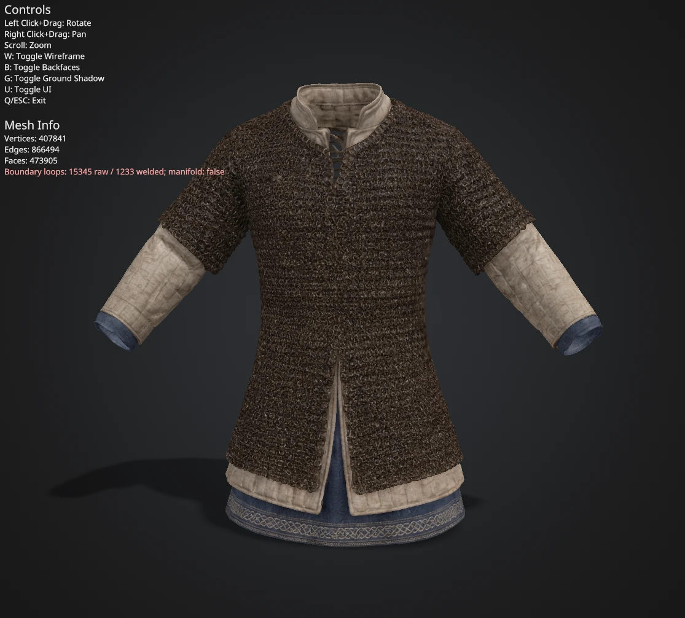

# msh — 3D mesh tools

`msh` is a command-line tool for inspecting, rendering, analyzing, and processing
3D meshes. It includes an interactive viewer and a windowless renderer for
repeatable captures and automation.



## What it does

- View textured meshes, glTF materials and skeletal animations, or view BVH motion directly.
- Render PNGs and sprite sheets with configurable cameras, lighting and backgrounds.
- Inspect topology, including raw and position-welded boundaries and manifoldness.
- Repair, remesh, simplify and prepare meshes for game LODs.
- Control a viewer or a persistent offscreen renderer over local JSON-RPC.

Mesh input formats are OBJ, GLB, glTF and 3MF. Mesh processing writes OBJ or
GLB, selected by output extension; rendering writes PNG. BVH is supported by
the standalone motion viewer and as an animation overlay on compatible skins.
Mesh processing can change geometry and does not preserve every source material
or attribute; inspect the output for your intended use.

## Installation

Install the `msh` executable from crates.io with Rust and Cargo:

```bash
cargo install mshmash --locked
```

Remote control is enabled by default. To add RenderDoc support, install with
`cargo install mshmash --locked --features renderdoc`. To build the current
checkout instead, run `cargo install --locked --path .`.

The viewer and renderer use Metal on macOS and Vulkan on other platforms. Set
`WGPU_BACKEND` (for example `vulkan`, `metal`, `dx12` or `gl`) to choose a
different wgpu backend.

## Quick start

```bash
msh view model.glb
msh view scene.glb --mesh all
msh view motion.bvh
msh stats model.glb --json
msh render model.glb --out model.png --width 800 --height 600
msh fix broken.obj --out repaired.obj
msh clean model.glb --out lod.glb --ratio 0.5 --preserve-weights
```

Run `msh --help` or `msh <command> --help` for all options.

### Interactive viewer

Drag with the left mouse button to orbit, drag with the right button to pan,
and scroll to zoom. **W** toggles wireframe, **B** highlights backfaces, **G**
toggles the ground shadow, **U** toggles the overlay, and **Q** or **Escape**
quits. For a multi-mesh glTF, the viewer starts with the first mesh; **N/P**
cycle through meshes. Select one with `--mesh name` or load active scene meshes
and instances together with `--mesh all`.

```bash
msh view character.glb --animation walk
msh view character.glb --clips animations.glb --animation walk
msh view character.glb --bvh motion.bvh
```

The ground shadow follows the mesh and light and is hidden from below. Use
`--no-ground` to disable it. Transparent backgrounds and the `sprite-bake`
preset omit it. The viewer supports material textures, alpha modes, normal,
metallic-roughness and occlusion maps; see the automation notes below for glTF
and skin limitations.

### Render and animate

```bash
msh render model.glb --out preview.png --width 1024 --height 1024
msh render character.glb --animation walk --frames 0-15 --angles 8 \
  --sprite-sheet --transparent-bg --out walk.png
msh render model.obj --angles 8 --sprite-sheet --width 128 --height 128 \
  --transparent-bg --out turntable.png
```

Use `--camera-pos` and `--camera-target` for a fixed view, `--shading` for lit,
flat or unlit output, and `--preset sprite-bake` for sprite-oriented settings.
`--frame` selects one animation frame; `--frames` samples a range.

### Analyze and process

```bash
msh stats model.glb --json --weld-tolerance 0.000001
msh check model.obj
msh inspect-glb scene.glb --json
msh remesh model.obj --out remeshed.obj --target-edge-length 0.005
msh remesh voxel model.obj --out voxel.obj --size 0.02
msh remesh simplify model.glb --out simplified.glb --ratio 0.5 --preserve-weights
msh clean model.obj --out lod.obj --ratio 0.5
```

`stats` reports raw and position-welded topology separately. A manifold surface
may have boundaries; use `is_closed` when a closed surface is required. Neither
result proves the absence of self-intersections. `fix`, `remesh`, and `clean`
modify geometry; retain the source and inspect the result. `--preserve-weights`
transfers weights by nearest vertex where supported.

## Remote Control & RenderDoc Features

### Remote Control (Feature: `remote`)

Control the mesh viewer remotely via JSON-RPC. Perfect for automated workflows, scripting, or external tool integration.

#### Agent automation

Use a persistent windowless renderer for repeatable captures:

```bash
msh serve --port 9002 --size 800x600 --no-ground --shading flat
msh remote --port 9002 load garment.glb --clips clips.glb
msh remote --port 9002 set-animation walk
msh remote --port 9002 set-time 0.25
msh remote --port 9002 camera --eye=0,0.2,3 --target=0,0,0
msh remote --port 9002 screenshot shots/front.png
msh remote --port 9002 backface-stats
```

`serve` creates no desktop window and captures exactly the requested dimensions.
For a visible viewer, use `msh view --remote --port 9003 --title "Garment inspection"
--size 800x600`. A native window's initial size is a compositor hint; screenshot
acknowledgments report its actual size. `--no-vsync` selects a supported mode.

The default port remains 9001. Use `--port 0` on `view --remote` or `serve` for an
independent free port; the process prints `RPC_READY http://127.0.0.1:<actual-port>`
only after binding. Pass that port to every `msh remote --port N ...` command.
Bind errors cause startup to fail. Multiple agents can use separate endpoints.

RPC `load_model(path, mesh_name?, keep_camera?, clips?)` now waits for a successful
GPU upload and returns mesh statistics, including `triangles` and detailed
`topology`. `msh remote load --keep-camera` preserves the current camera. Failed
loads keep the previous valid scene. `screenshot(path)` waits until the PNG is
written and returns `{path, width, height}`; failures are RPC errors. Both CLI
commands print the returned JSON. Older clients expecting a string must update.
No stdout acknowledgment parsing or file-existence polling is needed.

Camera/state commands and captures run in order. A capture finishes before later
camera commands are applied. Use `set_camera(eye, target, up?, fov?)` to update a
whole pose atomically; exact top/down views have a stable up direction.

Batch captures use one `shoot(shots)` call, or `msh remote --port N shoot shots.json`:

```json
[
  {"eye": [0, 0.2, 3], "target": [0, 0, 0], "path": "shots/front.png"},
  {"eye": [3, 0.2, 0], "target": [0, 0, 0], "path": "shots/side.png"}
]
```

The batch completes without interleaving other commands and returns one
`{path, width, height, error}` result per shot. `error` is null on success; an
invalid camera or unwritable path does not drop subsequent shots. Optional
`up` and `fov` fields override those camera settings for a shot.

`backface_stats()` returns `backface_px`, its inclusive pixel `bbox`, `total_px`,
`covered_px`, and `material_px`. Counts come from a dedicated depth-tested integer
ID pass, not color thresholds. It counts the nearest fragment from either side;
MASK uses the material cutoff, and BLEND counts alpha >= 0.5 as covered. UI,
wireframe, lighting and ground are excluded. `material_px` sums duplicate or
unnamed labels; the `materials` array preserves each material's unique ID and name.

For visual diagnostics, use `--backfaces --backface-mode unlit` on `view` or
`render`, or RPC `enable_backfaces()` and `set_backface_mode("unlit")`. This emits
pure red while preserving material alpha cutouts. `lit` retains shaded red.
`enable_ground()`, `disable_ground()` and `toggle_ground()` control the ground
shadow; corresponding hyphenated CLI commands are available. **G** still toggles
it in a native viewer. Transparent output omits the shadow automatically.

`msh stats model.glb --json --weld-tolerance 0.000001` reports raw and
position-welded topology separately. The default tolerance is one millionth of
the bind-pose bounding-box extent, with a 1e-9 floor. Analysis leaves render UVs,
normals, materials and skinning untouched. `is_manifold` includes surfaces with
boundaries; use `is_closed` for a closed surface. Boundary loops are closed
boundary components, not proof that the mesh has no self-intersections.

Load all active scene meshes and instances with `--mesh all` (or RPC
`load_model(path, "all")`). Node transforms and reflected winding are preserved.
Combined skins must share joint nodes and inverse binds; palette order can differ.
Different rigs are rejected explicitly. Existing single-mesh selection and N/P
switching remain available. Unnamed meshes can be selected as `--mesh '#0'`.

`view` and `render` accept `--clips other.glb` for meshes with skins but no embedded
clips. RPC `load_clips(path)` attaches them to the current model;
`list_animations()`, `set_animation(name_or_index)`, `set_time(seconds)` and
`set_frame(frame, fps?)` provide deterministic paused poses. RPC frames use
`frame / fps`, defaulting to 30 FPS. The existing CLI `--frames` range retains
its evenly spaced sampling across the clip. Clip imports match unique joint
names and validate hierarchy, rest axes and scale. Rest-relative translation
transfer preserves target proportions; extra target helper joints retain their
rest transforms. Missing or incompatible joints produce errors.

Quantized `KHR_mesh_quantization` attributes and `EXT_meshopt_compression`
buffers are decoded, including octahedral, quaternion and exponential filters.
Texture-coordinate dequantization via `KHR_texture_transform` is applied per
texture. Textures currently use TEXCOORD_0. Triangle primitives and up to 256
joints are supported. Static meshes can also generate angle-only sprite sheets:

```bash
msh render model.obj --angles 8 --sprite-sheet --width 128 --height 128 \
  --transparent-bg --out atlas.png
```

Automation limits: 128 queued commands; 1 MiB RPC requests; 1–64 shots per batch;
8192 pixels per image axis and 16 megapixels per service image; 64 megapixels per
batch or sprite render. glTF source/decoded mesh buffers and expanded accessors
have 512 MiB budgets, and JSON metadata is limited to 64 MiB. The existing 256 MiB
viewer vertex-buffer limit is checked before triangle-soup allocation. Oversized
work returns errors. GPU captures have a bounded readback wait.

GPU regression checks (the second command opens one labeled native window):

```bash
cargo test --test automation offscreen_automation_contract -- --ignored --nocapture
cargo test --test automation native_automation_contract -- --ignored --nocapture
# Optional compressed-fixture check:
GLTFPACK=/usr/bin/gltfpack cargo test --test automation offscreen_automation_contract -- --ignored
```

#### Enable Remote Control

Start the viewer with remote control enabled:

```bash
# Build with remote feature
cargo build --features remote

# Start viewer with RPC server
msh view model.obj --remote
```

By default the viewer binds `http://127.0.0.1:9001` and prints:

```text
RPC_READY http://127.0.0.1:9001
```

#### Remote Commands

Control the running viewer from another terminal:

**Load a Model**

```bash
msh remote load path/to/model.obj
msh remote load scene.glb --mesh "Body"
```

**Rotate the Model**

```bash
# Set absolute rotation (Euler angles in radians)
msh remote rotate 0 1.57 0

# Rotate around axis with angle notation
msh remote rotate-axis 0,1,0 90d    # 90 degrees around Y axis
msh remote rotate-axis 1,0,0 1.57r  # 1.57 radians around X axis
```

**Control Camera**

```bash
# Set camera position
msh remote camera-pos 5.0 3.0 5.0

# Set camera target (look-at point)
msh remote camera-target 0 0 0
```

**Toggle Display Options**

```bash
# Wireframe
msh remote enable-wireframe
msh remote disable-wireframe
msh remote toggle-wireframe

# Backface visualization (shows red reversed faces)
msh remote enable-backfaces
msh remote disable-backfaces
msh remote toggle-backfaces

# UI overlay
msh remote enable-ui
msh remote disable-ui
msh remote toggle-ui
```

**Get Mesh Statistics**

```bash
msh remote stats
```

The command prints the current mesh statistics as JSON.

**Take Screenshot**

```bash
msh remote screenshot output.png
msh remote screenshot captures/view.png    # Creates 'captures' dir if needed
msh remote screenshot deep/nested/dirs/shot.png  # Creates all parent dirs
```

**Capture Frame (RenderDoc)**

```bash
msh remote capture
msh remote capture /path/to/save.rdc
```

**Quit the Viewer**

```bash
msh remote quit
```

### RenderDoc Integration (Feature: `renderdoc`)

Capture GPU frames for debugging and analysis using RenderDoc.

#### Build with RenderDoc Support

```bash
cargo build --features renderdoc
# or with both features
cargo build --features remote,renderdoc
```

#### Capture Frames

**Launch with RenderDoc:**

```bash
# Build with RenderDoc support
cargo build --features renderdoc --release

# Launch through RenderDoc
renderdoccmd ./target/release/msh view model.obj
# or
qrenderdoc  # Then use GUI: File -> Launch Application
```

When launched through RenderDoc, F12 will capture frames (injected by RenderDoc).

**Via Remote Control:**

```bash
# Terminal 1: Launch with both features
cargo build --features remote,renderdoc --release
renderdoccmd ./target/release/msh view model.obj --remote

# Terminal 2: Trigger capture remotely
msh remote capture                               # Default RenderDoc location
msh remote capture "captures/my_mesh"            # Relative to your current directory
msh remote capture "/tmp/debug/mesh_analysis"    # Absolute path
```

The path parameter sets RenderDoc's capture file path template:

- **Relative paths** are resolved from your current working directory (where you run `msh remote`)
- **Absolute paths** are used as-is
- RenderDoc appends a timestamp and `.rdc` extension to the final file

**Note:** RenderDoc works by injecting itself into your application process. The app must be launched through RenderDoc (via `renderdoccmd` or the RenderDoc GUI) for frame capture to work.

### Angle Notation

The remote control system supports flexible angle notation:

- **Degrees**: `90d`, `180d`, `45d`, `-90d`
- **Radians**: `1.57r`, `3.14r`, `0.785r`
- **No unit** (interpreted as radians): `1.57`, `3.14`

Examples:

```bash
msh remote rotate-axis 0,1,0 90d      # Quarter turn
msh remote rotate-axis 1,0,0 180d    # Half turn
msh remote rotate-axis 0,0,1 1.57r   # ~90° in radians
```

### Example Workflow: Automated Inspection

```bash
# Terminal 1: Start viewer with remote control
msh view model.obj --remote

# Terminal 2: Automate inspection with screenshots
msh remote rotate 0 0 0                     # Reset rotation
msh remote camera-pos 10 5 10               # Position camera
msh remote enable-wireframe                 # Show wireframe
msh remote rotate-axis 0,1,0 45d           # Rotate 45° around Y
msh remote screenshot "shots/front_view.png"  # Take screenshot

msh remote rotate-axis 0,1,0 90d           # Rotate another 90°
msh remote screenshot "shots/side_view.png"   # Another screenshot

msh remote disable-wireframe                # Toggle for comparison
msh remote screenshot "shots/side_shaded.png"

msh remote stats                            # Get mesh info
```

**With RenderDoc for GPU debugging:**

```bash
# Terminal 1: Start with RenderDoc
renderdoccmd msh view model.obj --remote

# Terminal 2: Mix screenshots and RenderDoc captures
msh remote screenshot "analysis/mesh.png"        # High-level view (PNG)
msh remote capture "analysis/mesh"               # GPU-level capture (.rdc)
```

**Note:**

- Launch with `renderdoccmd` to enable frame capture. Without it, `msh remote capture` will report that RenderDoc is not available.
- Relative paths are resolved from your current directory, so if you're in `/home/user/projects/models/`, the path `"captures/front_view.png"` becomes `/home/user/projects/models/captures/front_view.png`.
- Parent directories are automatically created for screenshots, so `"output/shots/view.png"` will create the `output/shots/` directory structure if it doesn't exist.

### JSON-RPC API

The RPC server implements JSON-RPC 2.0 over HTTP. You can also call methods directly:

```bash
curl -X POST http://127.0.0.1:9001 \
  -H "Content-Type: application/json" \
  -d '{"jsonrpc":"2.0","method":"set_rotation","params":[0,1.57,0],"id":1}'
```

Available methods:

- `load_model(path, mesh_name?, keep_camera?, clips?)` — returns statistics after upload
- `set_rotation(x: f32, y: f32, z: f32)`
- `rotate_around_axis(axis: Vec<f32>, angle: String)`
- `set_camera_position(x: f32, y: f32, z: f32)`
- `set_camera_target(x: f32, y: f32, z: f32)`
- `enable_wireframe()` / `disable_wireframe()` / `toggle_wireframe()`
- `enable_backfaces()` / `disable_backfaces()` / `toggle_backfaces()`
- `enable_ui()` / `disable_ui()` / `toggle_ui()`
- `get_stats()` → `{vertices, edges, faces, is_manifold, holes}`
- `screenshot(path)` — returns `{path, width, height}` after saving the PNG
- `capture_frame(path: Option<String>)` (requires `renderdoc` feature)
- `quit()` - Exit the viewer

## Feature Flags

- **`remote`** (enabled by default): Enables JSON-RPC server and remote control CLI
  - Dependencies: jsonrpsee, tokio, crossbeam
  - Build: `cargo build --features remote`

- **`renderdoc`**: Enables RenderDoc frame capture
  - Dependencies: renderdoc crate
  - Build: `cargo build --features renderdoc`

- **Both**: `cargo build --features remote,renderdoc`
